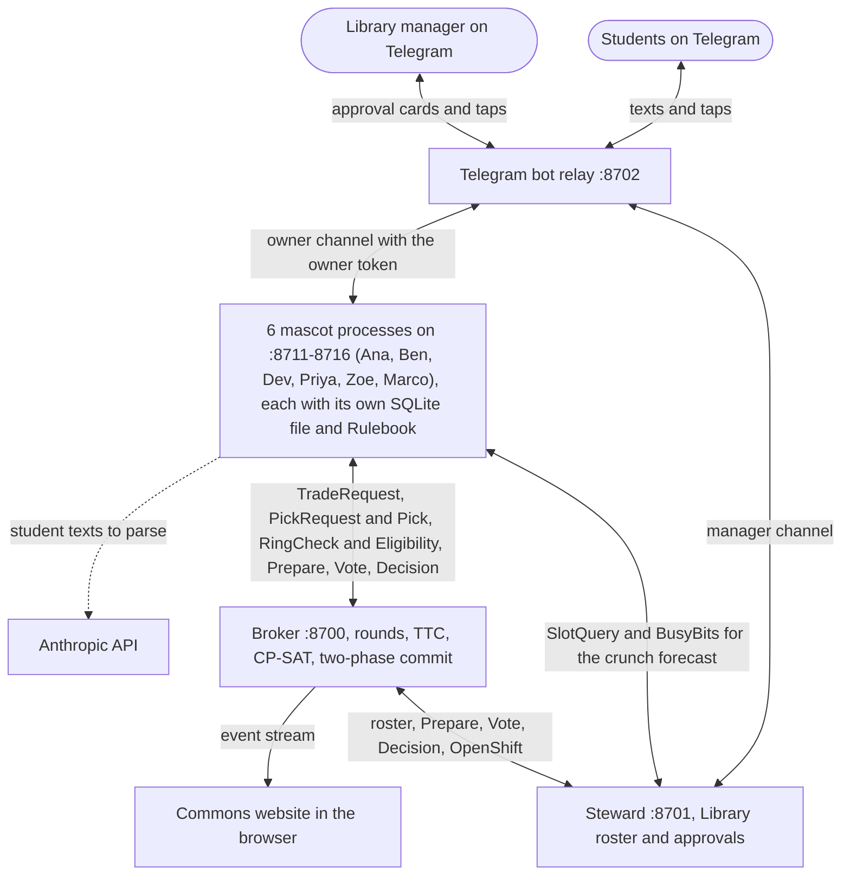
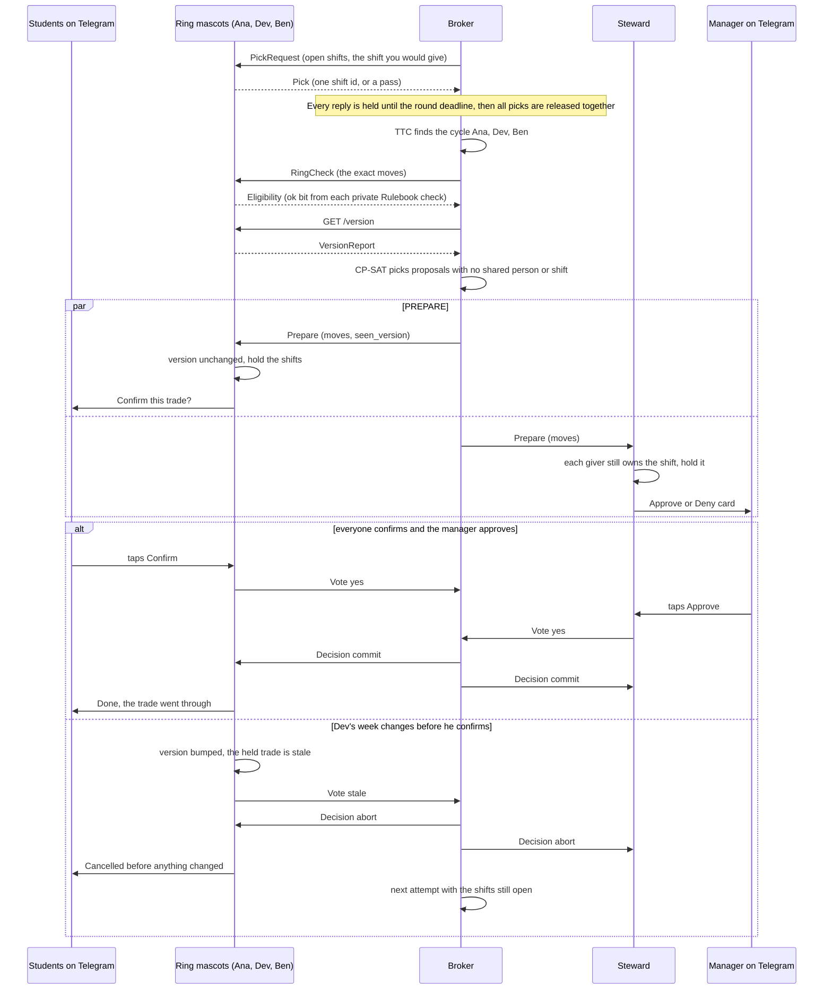
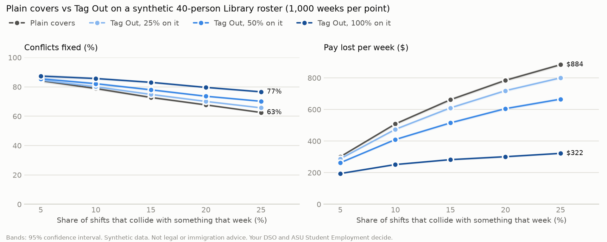

# Tag Out

Ben is on an F-1 visa. He works 8 hours a week at the Library and 9 at Aramark Dining, which the Library can't see, so a scheduler that only sees Library hours (the baseline in the judge view) would hand him a coworker's shift that puts him at 21 of his 20 allowed hours across on-campus jobs. Tag Out gives each ASU student worker a mascot agent that privately holds their calendar, shifts and work-hour limits, texts them only when next week's shift collides with something (or when they text that they're sick), and trades shifts with coworkers' mascots through a broker that sees shift ids and yes/no answers, never reasons, hours or which rule applies. Each mascot re-checks the exact trade against ASU's cited limits, and nothing moves until every student in it confirms and the manager approves (or the trade is a swap that passes the manager's standing rule).

Why: about 10,000 students work at ASU each year ([ASU Work+](https://workplus.asu.edu/learn-more/impact)), and when a shift collides with an exam or an interview, ASU's advice is to "be proactive about finding shift coverage" ([ASU Student Employment](https://studentemployment.asu.edu/students/starting-your-role/developing-schedule)), so in practice the search for cover starts with the student, while the supervisor still owns the schedule. Students talk to their mascot on Telegram. A Cubbie Skill is included so Cubbie can be that chat; it is tested against a running mascot over HTTP, not yet inside Cubbie.

Built for DevHacks S3 x Cubbie, Track 2 (agent-to-agent coordination). Every student, calendar and number in the demo is synthetic.

## Try it in your browser: https://tag-out.vercel.app

No install. The hosted page replays a recording of the real system (`scripts/record.py` runs every agent and saves what they sent), so every message you see really crossed between separate agents. To type and tap yourself, run it locally (Quick start).

1. Press **Play the week**. The mascots check next week, trade in a three-way ring and a cover chain; the manager approves the cover, and the ring passes on the manager's standing rule for swaps. 4 of 5 collisions get fixed and $192 of pay is kept.
2. **Sign in** as Ben (top right). You see his private week, his chat with his mascot ("You'd be at 17 of your 20 hours across all on-campus jobs") and what his coworkers can and can't see. Tap "I'm sick, can't make it today" to replay his same-day call-out.
3. Open **Manager**. Approvals arrive in the inbox; post an extra shift or find a team meeting time to replay what the agents did with it.
4. Open **Org chart** and press **Play the morning**. 16 student workers in three departments and the people above them (3 shift leads, 3 managers, 2 backup managers, Environmental Health and Safety, Student Employment, ISSC: 27 agents, each with its own pet) handle a call-out nobody can cover, a safety report and an F-1 question. Watch the case climb one rung each time a timer runs out; click anyone to read their phone.
5. Open **How it works**. Every message between the Library's agents appears in a live graph (the hierarchy's are on the Org chart) whose blocks you can drag like n8n nodes (pan, zoom, Fit, Reset layout); click one to read exactly what crossed. The counters show 0 fields outside the schemas and 0 private labels in any message. **Snoop** has a nosy broker ask every mascot why it passed: the closed schemas reject the question, and no mascot vouches for a shift it never picked.
6. Open **Judge view** for the private limits and what a Library-only scheduler would have done to the same week (Ben at 21 of 20 hours). **Exit judge view** (top right of the red banner) or any tab takes you back.

## What happens in the demo week

The demo roster is six synthetic student workers at the Library for the week of Monday Oct 26 2026 (`seeds/scenario.py`). Each mascot loads its student's week through the real ingest path: a Canvas feed, a personal calendar and the Library's shift export as ICS files, plus texts parsed by Claude with a regex fallback.

### Sunday check

Five mascots find a collision and text their student. Priya has none, so her mascot stays quiet. The broker sends the Sunday check and gets an empty reply, so it never learns how many collisions anyone has.

| Student | Library shift | Collides with | Where the mascot found it |
|---|---|---|---|
| Ana | Tue 6-10 PM | the evening before her CSE 310 midterm, which her mascot protects for exam prep | her Canvas feed |
| Ben | Thu 2-6 PM | an Amazon interview at 3 PM | his text "I got the Amazon interview Thu 3pm!!" |
| Dev | Fri 10 AM-2 PM | a dentist appointment at 11 AM | his calendar |
| Zoe | Sat 10 AM-2 PM | her sister's wedding in Flagstaff | her calendar |
| Marco | Wed 2-6 PM | the fall career fair | his text "fall career fair wed 1-4, need to be there" |

All five tap "Find a trade". The only thing that leaves each mascot is the shift id.

### Trade rounds

1. The first swap round finds no ring. Ben's mascot picks Ana's Tuesday and Dev's picks Ben's Thursday. The only open shift Ana could take is Dev's Fri 10 AM-2 PM, and that is the slot she keeps for the gym with her roommate. That is a preference, not a rule, so her mascot passes and asks her: "A Fri 10 AM-2 PM Library shift could come to you in a trade, but that's your gym with your roommate slot. Take it so you keep your pay this week?"
2. Ana taps "Take it". In the round after the counter-offer window, her mascot counter-offers by picking Dev's Friday, and the ring Ana -> Dev -> Ben closes: Ana takes Dev's Fri 10 AM-2 PM, Dev takes Ben's Thu 2-6 PM, and Ben takes Ana's Tue 6-10 PM. All three keep their hours and their $64.
3. Nobody can swap with Zoe, so her Saturday goes to a cover round. Priya wants more hours and has room, so she covers it. Zoe gives up that shift's pay.
4. Marco's Wed 2-6 PM has no safe trade, and Tag Out says so. Every coworker is in class or already on shift that afternoon, including Priya, the only one who wants extra hours. The broker hands it to the manager as an open shift with no reason attached: "Open shift: Wed 2-6 PM (was Marco's). No safe trade this week. Post it or cover it?"
5. Before anything moves, each mascot re-checks the exact ring or chain it is in against its own Rulebook, CP-SAT keeps the proposals whose members all said ok and that share no person or shift (this week nothing overlaps, so it keeps both; it matters when a re-check fails or proposals compete), and the two-phase commit asks each student to confirm on Telegram and the manager to approve.

The week ends with 5 asked, 4 fixed (3 by the ring, 1 by Priya's cover), 1 open shift, and $192 of pay kept: the three ring shifts at 4 hours and $16 an hour each. `tests/test_flow.py` checks each of these numbers.

### Ben's 17 hours

Ben is an F-1 student, so he may work at most 20 hours a week across all on-campus jobs. He works 9 hours a week in Dining, which the Library can't see, and 8 at the Library, so he is at 17 of 20. A plain cover of Ana's Tuesday would put him at 21. The ring keeps him at 17, and his confirm text says so: "You'd be at 17 of your 20 hours across all on-campus jobs." Only Ben sees that line. The broker and the manager only learn that his mascot said yes.

### Break it

`python -m scripts.demo --break-it` (or `POST /demo/break` on the broker) changes Dev's week after the ring is prepared and before he confirms: he texts "physical therapy thu 3pm". His mascot's schedule version goes up, it votes stale on the held trade, and the ring aborts with every shift where it was. Ana, Ben and Dev each get "That trade was cancelled before anything changed. Your shifts are exactly as they were." Priya's cover of Zoe's Saturday is a separate transaction and still commits.

The broker then runs a second attempt. Dev can't take Ben's Thursday any more, so no ring closes, and the retry commits the chain Priya -> Ben -> Ana -> Dev instead: Priya covers Ben's Thu 2-6 PM, Ben takes Ana's Tue 6-10 PM, Ana takes Dev's Fri 10 AM-2 PM, and Dev drops his Friday. The week still ends with 4 of 5 fixed (`test_editing_a_week_before_commit_aborts_and_retries`). Priya, also on an F-1, would end that week at exactly 20 of her 20 hours with no slack to stay late, so her mascot asks her first (the safe answer comes first) instead of picking the shift on its own.

### Same-day call-out

Sunday doesn't catch everything. On Monday morning Ben texts his mascot "I woke up sick, can't make it Monday". The mascot finds his Mon 10 AM-2 PM shift, marks it busy, and sends the broker the shift id with `urgent`, nothing else, so the broker opens a cover round right away instead of waiting for Sunday. Priya would hit exactly 20 of her 20 F-1 hours, so her mascot asks her before picking it. Zoe, who gave up her Saturday for the wedding, has room and takes it, which gets her the $64 back. Ben confirms ("You'd be at 13 of your 20 hours across all on-campus jobs"), Zoe confirms, the manager approves, and the shift moves. The Sunday numbers don't change, Marco doesn't get a second "no trade" text, and the word "sick" never appears in any message between agents (`tests/test_callout.py`). If nobody can take a call-out safely, it goes to the manager as an open shift, the same as on Sunday. When the text names no day, the mascot replies with one button per shift that week.

## When nobody can cover: the campus hierarchy

A same-day call-out that no coworker can take shouldn't sit in one manager's inbox. For Dining and the Rec center, Tag Out adds the chain of command above the mascots (the Library's call-outs still go to its manager, the Steward, as above; its shift lead sees a copy). Each employer keeps its own chain (`seeds/org.py`): the Rec center is ASU (Sun Devil Fitness) and follows a Workday supervisory org, while Dining is Aramark, a separate employer on campus with its own managers. There are ten more synthetic students in Dining (Aramark at the Memorial Union) and the Rec center front desk, plus Ben and Dev, who already work in two departments, Raj, who works at both the Rec center and Dining, and Omar and Ivy, who also work for Aramark at the Barrett dining hall. Above them, each of these is its own agent with its own inbox (`org/app.py`):

| Rung | Who | Waits (never past the shift's start) | Then |
|---|---|---|---|
| 1 | the department's shift lead (Jordan, Nia for Aramark, Theo) | 2 h, asking every coworker in the department now and again halfway; the manager hears about the call-out at once | moves the case to the department manager |
| 2 | the department manager (Aramark's unit manager for Dining) | 30 min | moves it to that employer's backup |
| 3 | Aramark's general manager for Dining, the Rec assistant director (Sun Devil Fitness) for the Rec center | 30 min | can offer the shift only to students who already work that job for the same employer elsewhere, or excuse the student and have staff cover it; otherwise the case stays open on their list, flagged |
| - | ASU Environmental Health and Safety | 60 min | gets every safety report from an ASU workplace at once, alongside the manager on duty |
| - | ASU Student Employment | the week | logs each ASU case as it closes, by department and outcome, for the week's report: no names, shifts or reasons |
| - | ISSC, the international students office | 2 business days | F-1 questions only, and only when the student taps Send |

**Messages can't be faked from outside.** Every message down to a student's mascot (an excuse, an ISSC answer, an acknowledgment) must echo a secret that mascot made, and every escalation or case update carries a signature only the hierarchy's agents can make (`tests/test_org_breakit.py`).

**Silence counts as no.** A timeout moves a case up one rung and never approves anything; with nobody answering anywhere, the case ends open at the top and no shift moves (`test_silence_never_approves`). What climbs is an `Escalation` with the shift id and the rule that moved it (`no_cover_2h`, `no_answer_30m`, `safety_first`), never the student's reason. When a rung closes the case, every rung below it gets a `CaseUpdate` and stops its timer.

**The recorded morning** (the Org chart page, `tests/test_org.py`):

- 6:30 AM Lena texts "I woke up sick, can't make my Saturday shift". Nia, the Dining shift lead, asks the six people who work at Dining, then asks again at 7:30. All six pass, each for a reason only its own mascot knows: Kofi and Mei don't want hours, Diego is moving apartments, Hana never works Saturdays, Ben doesn't want hours, and Raj would be at 22 of his 20 F-1 hours across his Rec and Dining jobs. Nia and the Dining manager only ever see six passes.
- 8:30 AM, 2 hours without a cover: the case moves to the Dining manager, who is in a meeting all morning.
- 9:00 AM, 30 minutes of silence: it moves to Aramark's general manager, who offers it only to students who already work for Aramark at the other dining hall. Omar picks it and Ivy passes; Lena and Omar confirm on their phones, and the case closes before the 10 AM shift. Nia and the Dining manager are told, so their timers stop. (The general manager could instead excuse Lena and have staff cover it: her mascot then tells her she doesn't have to find anyone.)
- A safety report ("the fire exit by the weight room is blocked") doesn't wait for a ladder: the Rec manager on duty and ASU Environmental Health and Safety both get it at once and acknowledge it separately, and Tess hears from each by name. Student Employment only sees the week's count.
- Kofi asks "Can I work 40 hours over winter break on my F-1 if I graduate in December?". His mascot doesn't answer visa questions; it shows him the exact words it would send ISSC and waits for Send. ISSC gets only the question, replies with the rules ASU publishes on break hours and program completion, and flags it for an advisor (DSO); the case stays open until an advisor replies.

Locally the hierarchy runs as its own process next to the Library's (`scripts/run_org.py`, started by `run_all`, ports 8721-8740): every rung and every Dining or Rec mascot is its own app with its own state (each mascot its own SQLite file), sharing one event loop and one story clock where a story minute is 0.05 s (`TAGOUT_ORG_MINUTE`). Environmental Health and Safety, Student Employment and ISSC are thin on purpose: they acknowledge, count, or reply with the cited rule and book a human; a person decides.

## Beyond trades: the rest of a student worker's week

The same agents handle the other things that come up around shifts, with the same rule: what leaves a mascot is busy-or-free bits, picks and yes/no answers, plus whatever the student chooses to send (an issue report). For meetings the Steward does receive each student's busy bits for the hours it asks about; the manager sees only counts.

- **Extra shifts.** The manager posts one ("Thu 6-10 PM"). The broker offers it to every mascot at once; each decides in private whether its student wants hours, is free and stays under every limit, and answers pick or pass. In the demo Zoe takes it; Ben (F-1 at 17 of 20) and Dev (25-hour average) pass without anyone learning why, and Priya's mascot asks her first because she'd hit 20 of 20.
- **Team meetings.** The Steward asks every mascot for one busy-or-free bit per hour next week, never what's on a calendar, and offers the manager the three best hours. Each student gets an invite and answers yes or no, with no reason.
- **A meeting with the supervisor.** "Set up a meeting with my supervisor": the mascot sends only the times its student is free, the Steward matches them against the manager's calendar, and the student picks one.
- **Reporting a problem.** "The printer at the desk is broken": the mascot drafts the report and asks how to send it (with their name or anonymously) before anything leaves. The manager can acknowledge it, and named reporters hear back.
- **Work-Study running out.** If a student's remaining Federal Work-Study award won't last until the next break at this week's pay, the mascot tells them once and suggests asking their supervisor or Financial Aid.

`tests/test_worklife.py` checks each of these.

## Quick start

Python 3.12.

```
python -m venv .venv
source .venv/bin/activate        # Windows: .venv\Scripts\activate
pip install -e ".[dev]"
python -m scripts.fetch_pets     # downloads the mascot art into web/pets/ (git-ignored)
python -m scripts.run_all        # 6 mascots, the Steward, the broker, and the Telegram bot if a token is set
```

Open http://127.0.0.1:8700 for the commons, where the mascots live (next section), with the roster, round log and simulator results below it, or http://127.0.0.1:8700/judge for the judge view, which adds the on-screen phones and the synthetic students' private numbers under a red banner. In a second terminal with the same virtual environment:

```
python -m scripts.demo --all     # the demo week, Ben's call-out, a reset, then the break-it beat
```

To rebuild the hosted replay after a change: `python -m scripts.record` (runs the real system in one process and writes `site/data/`), then `python -m scripts.build_site`, then deploy `site/` (for example `vercel deploy site --prod`).

By default the synthetic students tap their own buttons after a short delay. `python -m scripts.run_all --mode live` waits for real taps instead, and `--no-bot` skips Telegram. Logs go to `runtime/logs/`. Without an Anthropic key, text intake uses the committed cache in `seeds/llm_cache` and the regex parser, so the demo runs offline.

### Where the mascots live

The home page is the commons: a small square where all six mascots live on a canvas (`web/js/world.js`). They walk around using every animation in their pixel-art sprite sheet: idle, running left and right, waving when two of them meet, jumping, waiting, the review pose while they think, the failed pose on an abort, and the 16 look directions on version-2 pets, which they use to face a trade partner. When a trade round opens, the mascots whose students asked for a trade walk to the table; picks appear as grey arrows, a closed ring as blue arrows, and each confirm as a tick over the mascot. After the week they wander off again. You can drag a mascot anywhere, click one to open that student's chat with it, and change their size with the slider.

The chat panel next to the commons is each student's private thread with their own mascot (the same messages arrive on Telegram). The Pets button opens a picker that searches a public pet gallery (3,500+ pets), downloads the chosen sprite sheet into `web/pets/` and gives it to that student; no two students on a roster can share one. Fan art of copyrighted characters (for example the several Goku pets) works locally, but the default roster sticks to original art so a public demo video carries no third-party characters.

### Telegram

Why Telegram: it is the student's private line to their own mascot. It reaches them when the site is closed (the Sunday "your shift collides" text, a same-day call-out), one tap is the human step (Confirm, Decline, Take it, Approve; nothing moves without it), reasons go only to their own mascot while other agents get a shift id and a yes or no, and there is no new app to install. The bot only messages chats that registered themselves with `/start`, and Cubbie users can use the included Cubbie Skill instead.

No Telegram needed to judge it: every chat on the site (the commons chat, each student's page, the manager's page, the org chart inbox) is that same owner channel, with the exact messages and buttons the bot sends. The demo video shows the real Telegram chat next to the site. Trying the bot yourself needs the live system running and a join code, so the hosted page doesn't offer it.

1. Create a bot with BotFather. Put its token in a file named `api.env` one folder above the repo's parent, which is `../../api.env` relative to the repo root. The Anthropic key can go in the same file and is optional. Environment variables with the same names also work, and `TAGOUT_ENV_FILE` points to a different file.

   ```
   TELEGRAM_BOT_TOKEN=<token from BotFather>
   ANTHROPIC_API_KEY=<optional>
   ```

2. Start everything with `python -m scripts.run_all --mode live` so the mascots wait for your taps.
3. In Telegram, open your bot and send `/start`, then `/join ana <code>` with Ana's join code (`scripts/run_all.py` prints one code per student and the manager at startup). That chat is now Ana's phone. `/join manager <code>` from another chat gets the manager's approval cards. `/cubbie` sends that student's mascot address and owner token for the Cubbie Skill. Telegram carries plain text and buttons only; the mascots themselves live on the website. Other commands: `/week` lists your shifts, `/diary` shows your room before your tightest limit, `/sunday` runs the Sunday check, `/trade` starts the rounds.

## How it plugs into Cubbie

Cubbie already reads a student's Canvas and Google Calendar and texts them. In Tag Out that makes Cubbie the natural front door to the student's mascot, so the repo includes a Cubbie Skill, [`cubbie-skill/tag-out/`](cubbie-skill/tag-out/SKILL.md), that passes the kit's validator (`validate_cubbie_skill.py`):

- Every Sunday at 6 PM (a Cubbie scheduled check-in) Cubbie reads next week's Canvas exams and due dates and calendar events with its own abilities and hands them to the student's mascot through the owner channel (`POST /import`). The titles stay with the student's mascot; coworkers and the employer only ever see "busy".
- Cubbie relays the mascot's texts (the collision, the "it's your gym slot, take it?" question, the confirm card) to the student by text and taps their answer back (`tagout.py inbox`, `tagout.py answer <code>`). It never answers for the student.
- `python cubbie-skill/tag-out/scripts/tagout.py --sample inbox` runs the whole walk-through offline. The script uses only the Python standard library, as Cubbie's sandbox expects, and the owner token comes from Cubbie's secure input.

So a student's Cubbie can be the front door to their mascot: it already knows their week, and the mascot trades through the broker without anyone sharing why. `tests/test_cubbie_skill.py` runs the script against a live mascot over HTTP (setup, sync, tell, inbox, answer); it has not run inside Cubbie itself, and today the mascots listen on 127.0.0.1, so Cubbie would need the mascot hosted where it can reach it. The cleaner design is Cubbie hosting each student's mascot, so only the `core/wire.py` messages ever leave Cubbie. Telegram (`bot/`) is the same owner channel for students who don't use Cubbie.

## What we took from ASU Workday

ASU student workers already live in Workday, so Tag Out follows its shapes (checked on a real student account; no data copied):

- Time is entered per day and per position, in Mon-Sun weeks inside a biweekly time period, and each entry is approved by the supervisor. Mascots read their hours history from a Workday-shaped time export (`seeds/workday/<student>_time.csv`, synthetic) through `ingest/workday.py`, summing every ASU position.
- The 25 h average counts ASU jobs only. Ben's Dining job is Aramark, which is not in Workday, so it counts toward his F-1 20 hours but not toward the 25 h average (`Limits.non_asu_employers`).
- The hire date starts the 25 h measurement period: the first 12 months after hire, then October to September (`rulebook.rules.measurement_window`).
- A shift needs a job profile, and a mascot never picks a shift its student's profile can't work (an instructional assistant can't cover a grader).
- The supervisory organization names the manager who approves time; that is who gets the Steward's approval card.

## The agents

| Agent | Runs as | Holds | Does |
|---|---|---|---|
| Mascot x6 (Ana, Ben, Dev, Priya, Zoe, Marco) | one FastAPI process each on ports 8711-8716, each with its own SQLite file `runtime/mascot_<id>.db` | its student's calendar as busy blocks with private labels, their Library shifts, their limits (F-1/J-1 flag, Federal Work-Study award left, hours at other employers, hours history), their preferences (wants more hours, days they never work, soft slots like Ana's gym time) and a private diary | runs the Sunday check; answers each round with one shift id or a pass; asks its student about a soft-preference shift and counter-offers in the next round; re-checks the exact final ring or chain; holds the shifts on PREPARE, asks its student to confirm, and votes yes, no or stale |
| Steward (one per employer, the Library here) | one process on port 8701 | the roster, which the employer already shares with its staff, and pending approvals | serves the roster; on PREPARE checks that each giver still owns the shift; sends the manager an Approve/Deny card and votes; tells the manager about shifts no trade could fill; gives a crunch forecast that reports a slot only when at least 3 staff are busy |
| Broker | one process on port 8700, which also serves the commons website and the event stream | shift ids, picks, ok bits, schedule version numbers and votes | runs Top Trading Cycles swap rounds, the counter-offer window and cover chains; asks every member for an ok bit on the exact final ring or chain; picks proposals with CP-SAT; runs the two-phase commit; retries after an abort |
| Rulebook | a library inside each mascot process (`rulebook/`), with no network and no LLM | the limits in `config/rules.yaml` and the quotes in `docs/rule_quotes.json`; reads one student's numbers at a time | returns eligible, blocked or unverified for a proposed change, with the deciding rule; missing hours history is unverified, never safe; refuses to cite a quote that isn't verbatim in `docs/RULES.md` |

| Mascot x10 more (Dining: Lena, Kofi, Mei, Diego, Hana; Rec center: Omar, Tess, Raj, Ivy, Sam) | the same mascot app, in the hierarchy's process on ports 8721-8730, each with its own SQLite file | the same kinds of private data for their own department's shifts | the same answers; their "broker" is their shift lead and their "steward" is their department manager |
| Shift leads x3, managers x2 (Dining, Rec), backup managers x2 (Aramark's general manager, the Rec assistant director), Environmental Health and Safety, Student Employment, ISSC | one app each in `org/app.py`, ports 8731-8740; the Library manager is the Steward | the cases they hold, their inbox, their timer | ask mascots for picks, run a two-phase commit for a cover, move a case up when their timer runs out, acknowledge reports, answer F-1 questions with the cited rule |

The Telegram bot (`bot/telegram_bot.py`, relay on port 8702) is each student's phone line, not an agent. It forwards texts and taps to the owning mascot with that mascot's owner token and delivers the mascot's messages.

TTC is a central matching step: the broker sees every mascot's pick and closes the cycles. The agent work happens in the mascots: they hold the private data and run the rule checks, ask their student when a pick touches a protected slot or comes near a limit, make the counter-offer, and only vouch for trades they asked for (a check about a shift a mascot never picked gets a plain no, so the broker can't use it to probe someone's room). Their ranking itself is simple (same part of the day first, then earliest).

## How it fits together



One trade, from the round to the commit:



A `no` vote, a Deny, or no answer before the vote timeout ends the same way as `stale`. [docs/ARCHITECTURE.md](docs/ARCHITECTURE.md) lists every endpoint, message type, round phase and commit state.

## Rules the mascots check

Every limit is data in `config/rules.yaml`. The quotes below come from `docs/rule_quotes.json`, and a test fails if any of them is not verbatim in [docs/RULES.md](docs/RULES.md), which has the full passages, the fetch dates and notes on where the sources disagree.

| Rule | Who | Quote | Source |
|---|---|---|---|
| 25 hours a week on average across all ASU jobs and stipends (`aca_25_avg`) | every ASU student worker | "To safeguard the academic success of every student, all student employees are limited to a rolling average of 25 hours per week for the year." | [SSM 305-05](https://public.powerdms.com/ASU/documents/1560576) |
| 20 hours a week in session, summed across every on-campus employer (`f1_weekly_20`) | F-1 and J-1 students | "You are not allowed to work more than 20 hours per week during the fall and spring semesters." | [ASU Student Employment, hourly limits](https://studentemployment.asu.edu/students/international-students/hourly-limits-and-work-rules) |
| 40 hours a week in ASU-listed break weeks (`f1_break_40`), only for students enrolled (or planning to enroll) for the next term, and no on-campus work after the program completion date | F-1 and J-1 students | "If you have more than one employer, you are only allowed to work for a total of 20 hours per week combined during the semester and 40 hours per week combined during the summer semester/winter or spring break." | [ASU Student Employment, hourly limits](https://studentemployment.asu.edu/students/international-students/hourly-limits-and-work-rules) |
| Earnings up to the award (`fws_award`) | Federal Work-Study students | "You can only earn up to the amount of your FWS award." | [ASU Student Employment, Federal Work-Study](https://studentemployment.asu.edu/students/preparing-student-employment/federal-work-study) |
| 40 hours a week (`weekly_40`) | everyone | "Students should not work more than a total of 40 hours per week." | [SSM 305-05](https://public.powerdms.com/ASU/documents/1560576) |
| No work during your own class time (`class_time`) | everyone | "Federal Work-Study or hourly student employees may not work during the hours they are scheduled to be in class." | [SSM 305-05](https://public.powerdms.com/ASU/documents/1560576) |

`docs/rule_quotes.json` also holds the two quotes in the pitch above (`stats` and `coverage_on_student`). Tag Out cites them but doesn't enforce them.

## Simulator results

`sim/simulate.py` plays 1,000 random weeks on a synthetic 40-person Library roster with clustered exam evenings, students who avoid Friday nights, and private limits (10% F-1, 20% Federal Work-Study). The headline case from `docs/simulation.json` is 15% of shifts colliding with something and the whole roster on Tag Out (seed 7):

| | Plain covers only | Group chat with two-person swaps (every volunteer checks all of their own limits correctly) | Tag Out |
|---|---|---|---|
| Conflicts fixed | 72.8% | 82.7% | 83.1% |
| Pay lost per week | $662 | $323 | $283 |

The honest reading: most of the gain over plain covers comes from simple two-person swaps, which a well-run group chat could also arrange. Tag Out adds only 0.4 points (± 0.3) of conflicts fixed over that stronger baseline and $40 a week less pay lost (rings of three or more and cover chains). What it changes is how the result is reached: the swaps happen on their own every Sunday instead of through a group chat; nobody posts a reason; and every move is checked against limits that no coworker or manager can see. That baseline assumes every volunteer checks every one of their own limits correctly. If nobody checks, the chat makes 1.49 limit-breaking covers a week on this roster (0.73 over the F-1 20 hours across jobs, 0.50 past a Work-Study award, 0.26 over the 25-hour average). If each volunteer checks by hand the obvious way (this job's hours under 20 or 40), it still makes 1.45, because what people miss is the other jobs, the rolling average and the award dollars. Tag Out's plans make none. (The 0.26 counts covers that would push a student's 25-hour average above 25 so far; the policy averages over the whole measurement period, so that is a caution, not yet a breach. The simulated broker also keeps the plain-cover plan in a week where it would do better; the live broker does not make that comparison yet.) The `docs/DESIGN.md` go/no-go (rings must add 10 points over plain covers) is met only narrowly (10.3 ± 0.5, and the gain mostly comes from two-person swaps), so rings are not the headline; the Sunday check, private limit checks and pay kept are ([docs/SIMULATION.md](docs/SIMULATION.md)).

Winter Break Handoff, per simulated break week (Dec 14 2026 to Jan 10 2027, when the F-1 limit is 40 hours for students continuing into spring; graduating F-1 students can't work after their completion date): students going home want 53.8 shifts gone, 32.3 of them are handed off to students who stay, and $2,066 of pay stays on campus. Accepted handoffs break 0 rules; an unchecked group chat would break about 3.7 a week.



The survey of ASU student workers that would set the real conflict rate is pending, so the conflict rate is swept from 5% to 25% instead of measured. Reproduce with `python -m sim.simulate --weeks 1000 --seed 7`.

## Questions we expect

**Isn't this a central algorithm with extra steps?** The matching step (TTC) is central and sees every pick; we say so. The agent boundary is about custody: each student's calendar, other jobs and limits live in their own mascot process, and the inputs can't be pooled because no employer can see the others. The judge view shows what a Library-only scheduler does with the same week: it offers Ben the Tuesday (it sees 12 Library hours, not his 9 at Aramark, so 21 of 20 F-1 hours) and Dev the Thursday (his rec center job is in Workday, but the Library's scheduler doesn't look there, so the shift pushes his 25-hour average over). A careful Ben would catch it himself; the point is that the scheduling tool can't (the Aramark hours are in no ASU system, and no scheduler checks Workday before offering a shift), so every check falls on the student. The mascots also do the part a solver can't: Ana's mascot asks her before trading into her gym slot, and Priya's asks before going within an hour of her F-1 limit.

**Is the demo week rigged?** Yes, it is a tour, tuned so each path shows once: a ring after a counter-offer, a cover, an honest open shift, and (in the break-it beat, a live edit) a stale abort. The simulator runs the same TTC, chain and Rulebook functions (`broker/ttc.py`, `rulebook/`) on 1,000 random 40-person rosters, without the processes, counter-offers or two-phase commit, and those are the numbers we quote.

**Why not a group chat that swaps?** If every volunteer checked all of their own limits correctly, a careful group chat would fix about as many collisions (82.7% vs 83.1%). Checking by hand the obvious way (this job's hours) still lets through about 1.45 limit-breaking covers a week on that roster, because the breaks come from other jobs, the rolling 25-hour average and Work-Study dollars; everyone also has to post why they need out, and someone has to organize it. Tag Out does it on Sunday without anyone asking or explaining.

**What about the morning someone wakes up sick?** That is the call-out path above: a text to the mascot, a cover round within seconds, the same private re-checks and confirms, and the manager gets the shift as an open shift if nobody can take it. The reason stays in the mascot; the broker only learns the shift is urgent.

**Who adopts it first?** The manager, per roster: the Sunday check works for a single student, the crunch forecast and the export are for managers, and rings need most of a roster on board (only 1.9 points at 25% adoption). For students, Cubbie is the distribution: the Skill makes a student's existing Cubbie their mascot's front door.

**Where does an approval land?** The Steward's roster updates and the manager downloads it as CSV or a calendar file for their scheduler or shared sheet. Students enter their time in Workday as they already do; nothing writes to Workday, which ASU controls.

## Privacy

The model:

- Every agent-to-agent message is a closed Pydantic schema in `core/wire.py` with `extra="forbid"` and `frozen=True`. A pick carries one shift id or nothing, an eligibility answer is one boolean, and a vote is yes, no, stale or timeout. There is no field for private hours, other jobs, reasons, rule names or event labels, so a message carrying one fails to parse. (Roster shifts carry start and end, so anyone on the roster can add up a coworker's hours at this employer, as they can today.)
- Each mascot is its own process with its own SQLite file. A student's calendar, limits and preferences live only in that file, and only that process opens it.
- Replies are released together at the round deadline, so how fast a mascot answered says nothing to the other agents or to the commons.
- Passes look identical. A pass because of the F-1 limit, a class, a preference or not wanting the shift is the same message, `"shift_id": null`.
- The no-leak test runs the whole demo week including the abort, records every agent-to-agent request and response, and fails if a key outside the wire schemas or any private string (every calendar label, preference label and other employer's name, plus words like "F-1" and "visa") shows up. It scans the public event stream and the manager's messages too.

Its limits:

- Separate processes protect a student's data from peers and from the employer, not from whoever runs the server. In this build every mascot runs on one machine, and its operator can open every database.
- The allowed fields can still leak a little over many weeks. Which shifts someone asks to trade, their picks and passes, and their stale or no votes are visible to the broker and, by name, on the public event stream the commons shows, and patterns build up.
- TTC is a central matching step. The broker sees every mascot's pick, though only the pick.
- The demo data is synthetic: the six students, their calendars, and the simulated roster.
- With an Anthropic key, the texts a student sends their mascot go to the Anthropic API to be parsed. With `TAGOUT_LLM_EXPLAIN=1`, so do the explanation texts a mascot sends its own student, which carry the private label and, for F-1 students, their hours. Rules and limits never go into a prompt.

[docs/PRIVACY.md](docs/PRIVACY.md) goes party by party and lists the remaining gaps, including peer endpoints that don't authenticate their caller and the Telegram path.

## Tests and CI

[](https://github.com/neric-joel/tag-out/actions/workflows/ci.yml)

```
ruff check .
pytest
```

`.github/workflows/ci.yml` runs both commands on every push and pull request with Python 3.12 and `TAGOUT_OFFLINE=1`, so CI never calls an API. The end-to-end tests mount every agent's app on one in-process HTTP client (`scripts/inproc.py`); each mascot keeps its own app and SQLite file, and only the transport changes.

| Suite | What it proves |
|---|---|
| `tests/test_rulebook.py` | Every cited quote is verbatim in `docs/RULES.md`. Ben's 9 Dining hours count, so a cover is blocked at 21 hours while a swap keeps him eligible. Break weeks raise the F-1 limit to 40. Missing history is unverified and blocks added hours. The 25-hour average, the Federal Work-Study award and class time each block. A Hypothesis property: no change the Rulebook allows ever breaks the 40-hour, F-1 or 25-hour-average limit. |
| `tests/test_ttc.py` | The demo ring needs the second round. Cycle finding matches a brute-force oracle on random pick graphs (Hypothesis). TTC never puts anyone in two cycles, only gives people shifts they picked, and never beats the oracle's bound. Chains end with someone dropping a shift. |
| `tests/test_twophase.py` | Under every mix of yes, no, stale and silent votes from three mascots and the Steward (Hypothesis), the commit happens only if all say yes, every participant gets the same decision, and an abort leaves the original owners. A forged vote without that member's ballot changes nothing. CP-SAT drops proposals with a no and proposals that overlap. |
| `tests/test_flow.py` | The full demo week end to end: Sunday texts only on collisions, 5 asked, 4 fixed, $192 kept, the counter-offer round, Ben's "17 of your 20 hours", Marco's open shift, and the break-it abort followed by the retry chain. |
| `tests/test_privacy.py` | The schemas reject a pick with `hours` or `reason`, an eligibility answer with a rule, a vote with a reason, and badges that describe limits. The no-leak scan over a full run with the abort. The reason still reaches its owner's phone. |
| `tests/test_baseline.py` | The same week through a Library-only scheduler (sees availability and Library hours, not other jobs) puts Ben at 21 of 20 F-1 hours and pushes Dev's 25-hour average over; the manager's CSV and calendar exports mark the traded shifts. |
| `tests/test_workday.py` | Workday-shaped time rows sum across positions by Mon-Sun week and skip sent-back entries; Aramark hours count for F-1 but not the ASU average; the measurement window starts at the hire date, then runs October to September. |
| `tests/test_cubbie_skill.py` | The Skill's sample mode runs offline, its description's first sentence fits Cubbie's 200-character list, items it imports become private busy time on the mascot, and the real client (`tagout.py`, not `--sample`) works over HTTP against a running mascot with the owner token enforced. |
| `tests/test_callout.py` | A same-day call-out opens its own round, tells the manager at once, never lets the student think they're already excused, doesn't disturb the Sunday numbers, and never puts the reason on the wire. |
| `tests/test_worklife.py` | Extra shifts go to someone who wants hours and fits every limit; team meetings use busy bits only; a supervisor meeting sends free times, not the calendar; issue reports leave only after the student says so; wire events hide ballots; a nosy broker learns nothing. |
| `tests/e2e/` | Opt-in browser tests (`TAGOUT_E2E=1`, Playwright): play the hosted week, sign in as Ben, the manager's inbox, the leak counters on How it works, and the live system's week. They pass against https://tag-out.vercel.app. |
| `tests/test_simulate.py` | Tag Out never fixes fewer conflicts or loses more pay than plain covers, no accepted move breaks a limit, the recheck catches a move nobody checked, the same seed gives the same results whatever the worker count, and Winter Break Handoff breaks no rule. |

## Stack

From `pyproject.toml` (minimum versions):

- Python 3.12
- FastAPI 0.162 and uvicorn 0.54 for every agent process, httpx 0.28 between them
- Pydantic 2.14 for the closed wire schemas
- OR-Tools 9.15 (CP-SAT) to choose which rings and chains run when proposals compete (in most weeks they don't overlap and it keeps all that passed)
- python-telegram-bot 22.8 with long polling and inline buttons
- icalendar 7.3 and recurring-ical-events 3.8 for Canvas, calendar and shift feeds
- sse-starlette 3.5 for the commons' event stream
- anthropic 2.3: Claude Haiku routes each student text (call-out, visa question, issue, meeting, more hours, calendar) and parses calendar items, and Claude Sonnet can rephrase a mascot's texts (model ids in `ingest/llm.py`). Claude only reads words; every work rule is code in `rulebook/`, never a prompt. Every response is cached, tests and recordings run offline on the regex rules, and `ingest/llm.py` stops calling the API once `TAGOUT_SPEND_CAP` dollars are spent (default $15 per machine). The key's budget (about $99) is split: at most $35 for building and test runs, $15 for recording the demo, and at least $45 kept for judges typing into the hosted page. On Vercel the cap ($1) and the rate limit (8 live runs per visitor every 10 minutes) are per warm instance, held in memory and `/tmp`, so the hard stop for the hosted page is the spend limit set on the key itself in the Anthropic Console.
- PyYAML 6.0 for `config/rules.yaml`, matplotlib 3.11 for the simulator chart (Pillow comes with it and cuts the pet frames for Telegram)
- SQLite from the Python standard library, one file per mascot
- Development: pytest 9, pytest-asyncio 1.4, Hypothesis 6.170, ruff 0.17

---

Not legal or immigration advice. Your DSO and ASU Student Employment decide.
