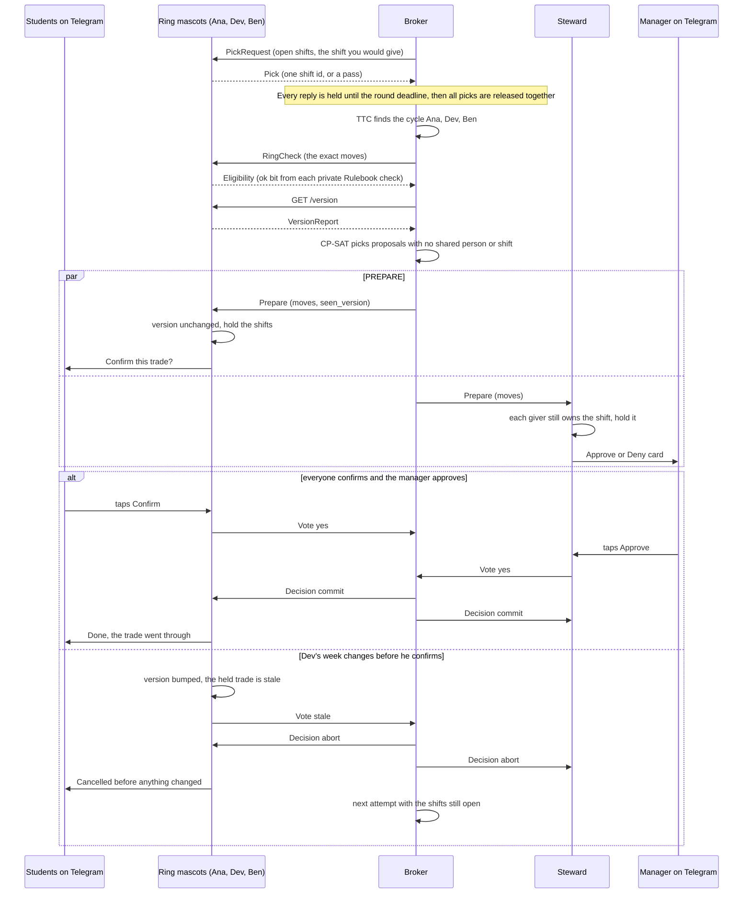

# Tag Out

About 10,000 students work at ASU each year ([ASU Work+](https://workplus.asu.edu/learn-more/impact)). When a shift collides with an exam or an interview, ASU's advice is to "be proactive about finding shift coverage" ([ASU Student Employment](https://studentemployment.asu.edu/students/starting-your-role/developing-schedule)), so finding cover is the student's job, and the coworker who takes the shift has no easy way to check it against limits that count hours from all of their campus jobs. Tag Out gives each student worker a mascot agent that privately holds their calendar and their shifts and knows which work-hour rules apply to them. Every Sunday it checks the coming week and texts its student only when a shift collides with something. Then the mascots trade shifts with each other in rings, through a broker that only ever sees which shift each mascot would take, so the people in a ring keep their hours and their pay and nobody has to say why they said no. Nothing changes until every student in the trade confirms on Telegram and the manager approves.

Built for DevHacks S3 x Cubbie, Track 2 (agent-to-agent coordination). Every student, calendar and number in the demo is synthetic.

## What happens in the demo week

The demo roster is six synthetic student workers at the Library for the week of Monday Oct 26 2026 (`seeds/scenario.py`). Each mascot loads its student's week through the real ingest path: a Canvas feed, a personal calendar and the Library's shift export as ICS files, plus texts parsed by Claude with a regex fallback.

### Sunday check

Five mascots find a collision and text their student. Priya has none, so her mascot stays quiet. The broker sends the Sunday check and gets an empty reply, so it never learns how many collisions anyone has.

| Student | Library shift | Collides with | Where the mascot found it |
|---|---|---|---|
| Ana | Tue 6-10 PM | the evening before her CSE 310 midterm, which her mascot protects for exam prep | her Canvas feed |
| Ben | Thu 2-6 PM | an Amazon interview at 3 PM | his text "I got the Amazon interview Thu 3pm!!" |
| Dev | Fri 10 AM-2 PM | a dentist appointment at 11 AM | his calendar |
| Zoe | Sat 10 AM-2 PM | her sister's wedding in Flagstaff | her calendar |
| Marco | Wed 2-6 PM | the fall career fair | his text "fall career fair wed 1-4, need to be there" |

All five tap "Find a trade". The only thing that leaves each mascot is the shift id.

### Trade rounds

1. The first swap round finds no ring. Ben's mascot picks Ana's Tuesday and Dev's picks Ben's Thursday. The only open shift Ana could take is Dev's Fri 10 AM-2 PM, and that is the slot she keeps for the gym with her roommate. That is a preference, not a rule, so her mascot passes and asks her: "A Fri 10 AM-2 PM Library shift could come to you in a trade, but that's your gym with your roommate slot. Take it so you keep your pay this week?"
2. Ana taps "Take it". In the round after the counter-offer window, her mascot counter-offers by picking Dev's Friday, and the ring Ana -> Dev -> Ben closes: Ana takes Dev's Fri 10 AM-2 PM, Dev takes Ben's Thu 2-6 PM, and Ben takes Ana's Tue 6-10 PM. All three keep their hours and their $64.
3. Nobody can swap with Zoe, so her Saturday goes to a cover round. Priya wants more hours and has room, so she covers it. Zoe gives up that shift's pay.
4. Marco's Wed 2-6 PM has no safe trade, and Tag Out says so. Every coworker is in class or already on shift that afternoon, including Priya, the only one who wants extra hours. The broker hands it to the manager as an open shift with no reason attached: "Open shift: Wed 2-6 PM (was Marco's). No safe trade this week. Post it or cover it?"
5. Before anything moves, each mascot re-checks the exact ring or chain it is in against its own Rulebook, CP-SAT picks which proposals to run, and the two-phase commit asks each student to confirm on Telegram and the manager to approve.

The week ends with 5 asked, 4 fixed (3 by the ring, 1 by Priya's cover), 1 open shift, and $192 of pay kept: the three ring shifts at 4 hours and $16 an hour each. `tests/test_flow.py` checks each of these numbers.

### Ben's 17 hours

Ben is an F-1 student, so he may work at most 20 hours a week across all on-campus jobs. He works 9 hours a week in Dining, which the Library can't see, and 8 at the Library, so he is at 17 of 20. A plain cover of Ana's Tuesday would put him at 21. The ring keeps him at 17, and his confirm text says so: "You'd be at 17 of your 20 hours across all jobs." Only Ben sees that line. The broker and the manager only learn that his mascot said yes.

### Break it

`python -m scripts.demo --break-it` (or `POST /demo/break` on the broker) changes Dev's week after the ring is prepared and before he confirms: he texts "physical therapy thu 3pm". His mascot's schedule version goes up, it votes stale on the held trade, and the ring aborts with every shift where it was. Ana, Ben and Dev each get "That trade was cancelled before anything changed. Your shifts are exactly as they were." Priya's cover of Zoe's Saturday is a separate transaction and still commits.

The broker then runs a second attempt. Dev can't take Ben's Thursday any more, so no ring closes, and the retry commits the chain Priya -> Ben -> Ana -> Dev instead: Priya covers Ben's Thu 2-6 PM, Ben takes Ana's Tue 6-10 PM, Ana takes Dev's Fri 10 AM-2 PM, and Dev drops his Friday. The week still ends with 4 of 5 fixed (`test_editing_a_week_before_commit_aborts_and_retries`). Priya, also on an F-1, ends that week at exactly 20 of her 20 hours.

## Quick start

Python 3.12.

```
python -m venv .venv
source .venv/bin/activate        # Windows: .venv\Scripts\activate
pip install -e ".[dev]"
python -m scripts.fetch_pets     # downloads the mascot art into web/pets/ (git-ignored)
python -m scripts.run_all        # 6 mascots, the Steward, the broker, and the Telegram bot if a token is set
```

Open http://127.0.0.1:8700 for the arena, or http://127.0.0.1:8700/judge for the judge view with the red DEBUG banner. In a second terminal with the same virtual environment:

```
python -m scripts.demo --all     # the demo week, a reset, then the break-it beat
```

By default the synthetic students tap their own buttons after a short delay. `python -m scripts.run_all --mode live` waits for real taps instead, and `--no-bot` skips Telegram. Logs go to `runtime/logs/`. Without an Anthropic key, text intake uses the committed cache in `seeds/llm_cache` and the regex parser, so the demo runs offline.

### Telegram

1. Create a bot with BotFather. Put its token in a file named `api.env` one folder above the repo's parent, which is `../../api.env` relative to the repo root. The Anthropic key can go in the same file and is optional. Environment variables with the same names also work, and `TAGOUT_ENV_FILE` points to a different file.

   ```
   TELEGRAM_BOT_TOKEN=<token from BotFather>
   ANTHROPIC_API_KEY=<optional>
   ```

2. Start everything with `python -m scripts.run_all --mode live` so the mascots wait for your taps.
3. In Telegram, open your bot and send `/start`, then `/join ana`. That chat is now Ana's phone. `/join manager` from another chat gets the manager's approval cards. Other commands: `/pet` picks a mascot, `/week` lists your shifts, `/diary` shows your room before your tightest limit, `/sunday` runs the Sunday check, `/trade` starts the rounds.

## The agents

| Agent | Runs as | Holds | Does |
|---|---|---|---|
| Mascot x6 (Ana, Ben, Dev, Priya, Zoe, Marco) | one FastAPI process each on ports 8711-8716, each with its own SQLite file `runtime/mascot_<id>.db` | its student's calendar as busy blocks with private labels, their Library shifts, their limits (F-1/J-1 flag, Federal Work-Study award left, hours at other employers, hours history), their preferences (wants more hours, days they never work, soft slots like Ana's gym time) and a private diary | runs the Sunday check; answers each round with one shift id or a pass; asks its student about a soft-preference shift and counter-offers in the next round; re-checks the exact final ring or chain; holds the shifts on PREPARE, asks its student to confirm, and votes yes, no or stale |
| Steward (one per employer, the Library here) | one process on port 8701 | the roster, which the employer already shares with its staff, and pending approvals | serves the roster; on PREPARE checks that each giver still owns the shift; sends the manager an Approve/Deny card and votes; tells the manager about shifts no trade could fill; gives a crunch forecast that reports a slot only when at least 3 staff are busy |
| Broker | one process on port 8700, which also serves the arena and the event stream | shift ids, picks, ok bits, schedule version numbers and votes | runs Top Trading Cycles swap rounds, the counter-offer window and cover chains; asks every member for an ok bit on the exact final ring or chain; picks proposals with CP-SAT; runs the two-phase commit; retries after an abort |
| Rulebook | a library inside each mascot process (`rulebook/`), with no network and no LLM | the limits in `config/rules.yaml` and the quotes in `docs/rule_quotes.json`; reads one student's numbers at a time | returns eligible, blocked or unverified for a proposed change, with the deciding rule; missing hours history is unverified, never safe; refuses to cite a quote that isn't verbatim in `docs/RULES.md` |

The Telegram bot (`bot/telegram_bot.py`, relay on port 8702) is each student's phone line, not an agent. It forwards texts and taps to the owning mascot with that mascot's owner token and delivers the mascot's messages.

TTC is a central matching step: the broker sees every mascot's pick and closes the cycles. The agent work happens in the mascots, which keep their preferences and rule checks private, ask their student when unsure, and make the counter-offer.

## How it fits together


One trade, from the round to the commit:



A `no` vote, a Deny, or no answer before the vote timeout ends the same way as `stale`. [docs/ARCHITECTURE.md](docs/ARCHITECTURE.md) lists every endpoint, message type, round phase and commit state.

## Rules the mascots check

Every limit is data in `config/rules.yaml`. The quotes below come from `docs/rule_quotes.json`, and a test fails if any of them is not verbatim in [docs/RULES.md](docs/RULES.md), which has the full passages, the fetch dates and notes on where the sources disagree.

| Rule | Who | Quote | Source |
|---|---|---|---|
| 25 hours a week on average across all ASU jobs and stipends (`aca_25_avg`) | every ASU student worker | "To safeguard the academic success of every student, all student employees are limited to a rolling average of 25 hours per week for the year." | [SSM 305-05](https://public.powerdms.com/ASU/documents/1560576) |
| 20 hours a week in session, summed across every on-campus employer (`f1_weekly_20`) | F-1 and J-1 students | "You are not allowed to work more than 20 hours per week during the fall and spring semesters." | [ASU Student Employment, hourly limits](https://studentemployment.asu.edu/students/international-students/hourly-limits-and-work-rules) |
| 40 hours a week in ASU-listed break weeks (`f1_break_40`) | F-1 and J-1 students | "If you have more than one employer, you are only allowed to work for a total of 20 hours per week combined during the semester and 40 hours per week combined during the summer semester/winter or spring break." | [ASU Student Employment, hourly limits](https://studentemployment.asu.edu/students/international-students/hourly-limits-and-work-rules) |
| Earnings up to the award (`fws_award`) | Federal Work-Study students | "You can only earn up to the amount of your FWS award." | [ASU Student Employment, Federal Work-Study](https://studentemployment.asu.edu/students/preparing-student-employment/federal-work-study) |
| 40 hours a week (`weekly_40`) | everyone | "Students should not work more than a total of 40 hours per week." | [SSM 305-05](https://public.powerdms.com/ASU/documents/1560576) |
| No work during your own class time (`class_time`) | everyone | "Federal Work-Study or hourly student employees may not work during the hours they are scheduled to be in class." | [SSM 305-05](https://public.powerdms.com/ASU/documents/1560576) |

`docs/rule_quotes.json` also holds the two quotes in the pitch above (`stats` and `coverage_on_student`). Tag Out cites them but doesn't enforce them.

## Simulator results

`sim/simulate.py` plays 1,000 random weeks on a synthetic 40-person Library roster with clustered exam evenings, students who avoid Friday nights, and private limits (10% F-1, 20% Federal Work-Study). The headline case from `docs/simulation.json` is 15% of shifts colliding with something and the whole roster on Tag Out (seed 7):

| | Plain covers | Tag Out |
|---|---|---|
| Conflicts fixed | 73.7% | 83.7% |
| Pay lost per week | $673 | $284 |

Rings and chains add 10.0 percentage points of conflicts fixed (95% CI 9.5 to 10.5) and cut pay lost per week by 58%.

The go/no-go is borderline. `docs/DESIGN.md` set the bar at 10 points, and the interval runs from 9.5 to 10.5, so the result neither clears it nor misses it with confidence. The points figure also moves with the assumptions: 4.5 if no conflicts cluster on shared exam evenings, 19.5 if helpers take at most one extra shift, and 1.9 if only 25% of the roster is on Tag Out ([docs/SIMULATION.md](docs/SIMULATION.md)). What rings clearly change is pay, because a swap fixes a conflict without anyone losing the shift. So the headline is the Sunday check, plain covers and the pay that trades save, with rings as the reason that pay is saved.

Winter Break Handoff, per simulated break week (Dec 14 2026 to Jan 10 2027, when the F-1 limit is 40 hours): students going home want 54.0 shifts gone, 34.6 of them are handed off to students who stay, and $2,215 of pay stays on campus. Accepted handoffs break 0 rules; an unchecked group chat would break about 3 a week (3.05).


The survey of ASU student workers that would set the real conflict rate is pending, so the conflict rate is swept from 5% to 25% instead of measured. Reproduce with `python -m sim.simulate --weeks 1000 --seed 7`.

## Privacy

The model:

- Every agent-to-agent message is a closed Pydantic schema in `core/wire.py` with `extra="forbid"` and `frozen=True`. A pick carries one shift id or nothing, an eligibility answer is one boolean, and a vote is yes, no, stale or timeout. There is no field for hours, reasons, rule names or event labels, so a message carrying one fails to parse.
- Each mascot is its own process with its own SQLite file. A student's calendar, limits and preferences live only in that file, and only that process opens it.
- Replies are released together at the round deadline, so how fast a mascot answered says nothing to the other agents or to the arena.
- Passes look identical. A pass because of the F-1 limit, a class, a preference or not wanting the shift is the same message, `"shift_id": null`.
- The no-leak test runs the whole demo week including the abort, records every agent-to-agent request and response, and fails if a key outside the wire schemas or any private string (every calendar label, preference label and other employer's name, plus words like "F-1" and "visa") shows up. It scans the public event stream and the manager's messages too.

Its limits:

- Separate processes protect a student's data from peers and from the employer, not from whoever runs the server. In this build every mascot runs on one machine, and its operator can open every database.
- The allowed fields can still leak a little over many weeks. Which shifts someone asks to trade, their picks and passes, and their stale or no votes are visible to the broker and, by name, on the public arena stream, and patterns build up.
- TTC is a central matching step. The broker sees every mascot's pick, though only the pick.
- The demo data is synthetic: the six students, their calendars, and the simulated roster.
- With an Anthropic key, the texts a student sends their mascot go to the Anthropic API to be parsed. With `TAGOUT_LLM_EXPLAIN=1`, so do the explanation texts a mascot sends its own student, which carry the private label and, for F-1 students, their hours. Rules and limits never go into a prompt.

[docs/PRIVACY.md](docs/PRIVACY.md) goes party by party and lists the remaining gaps, including peer endpoints that don't authenticate their caller and the Telegram path.

## Tests and CI

[](https://github.com/neric-joel/tag-out/actions/workflows/ci.yml)

```
ruff check .
pytest
```

There are 31 tests. `.github/workflows/ci.yml` runs both commands on every push and pull request with Python 3.12 and `TAGOUT_OFFLINE=1`, so CI never calls an API. The end-to-end tests mount every agent's app on one in-process HTTP client (`scripts/inproc.py`); each mascot keeps its own app and SQLite file, and only the transport changes.

| Suite | What it proves |
|---|---|
| `tests/test_rulebook.py` | Every cited quote is verbatim in `docs/RULES.md`. Ben's 9 Dining hours count, so a cover is blocked at 21 hours while a swap keeps him eligible. Break weeks raise the F-1 limit to 40. Missing history is unverified and blocks added hours. The 25-hour average, the Federal Work-Study award and class time each block. A Hypothesis property: no change the Rulebook allows ever breaks the 40-hour, F-1 or 25-hour-average limit. |
| `tests/test_ttc.py` | The demo ring needs the second round. Cycle finding matches a brute-force oracle on random pick graphs (Hypothesis). TTC never puts anyone in two cycles, only gives people shifts they picked, and never beats the oracle's bound. Chains end with someone dropping a shift. |
| `tests/test_twophase.py` | Under every mix of yes, no, stale and silent votes from three mascots and the Steward (Hypothesis), the commit happens only if all say yes, every participant gets the same decision, and an abort leaves the original owners. CP-SAT drops proposals with a no and proposals that overlap. |
| `tests/test_flow.py` | The full demo week end to end: Sunday texts only on collisions, 5 asked, 4 fixed, $192 kept, the counter-offer round, Ben's "17 of your 20 hours", Marco's open shift, and the break-it abort followed by the retry chain. |
| `tests/test_privacy.py` | The schemas reject a pick with `hours` or `reason`, an eligibility answer with a rule, a vote with a reason, and badges that describe limits. The no-leak scan over a full run with the abort. The reason still reaches its owner's phone. |
| `tests/test_simulate.py` | Tag Out never fixes fewer conflicts or loses more pay than plain covers, no accepted move breaks a limit, the recheck catches a move nobody checked, the same seed gives the same results whatever the worker count, and Winter Break Handoff breaks no rule. |

## Stack

From `pyproject.toml` (minimum versions):

- Python 3.12
- FastAPI 0.162 and uvicorn 0.54 for every agent process, httpx 0.28 between them
- Pydantic 2.14 for the closed wire schemas
- OR-Tools 9.15 (CP-SAT) to choose which rings and chains run
- python-telegram-bot 22.8 with long polling and inline buttons
- icalendar 7.3 and recurring-ical-events 3.8 for Canvas, calendar and shift feeds
- sse-starlette 3.5 for the arena's event stream
- anthropic 2.3: Claude Haiku parses student texts and Claude Sonnet can rephrase a mascot's texts (model ids in `ingest/llm.py`)
- PyYAML 6.0 for `config/rules.yaml`, matplotlib 3.11 for the simulator chart (Pillow comes with it and cuts the pet frames for Telegram)
- SQLite from the Python standard library, one file per mascot
- Development: pytest 9, pytest-asyncio 1.4, Hypothesis 6.170, ruff 0.17

## Credits

The mascots are pets from [Codex Pets](https://codex-pets.net), whose site code is MIT licensed ([portons/codex-pet-share](https://github.com/portons/codex-pet-share)). The pet art has no explicit reuse license, so `scripts/fetch_pets.py` downloads it at setup into `web/pets/`, which is git-ignored. The art is not in this repo. Creators, from `seeds/pets.json`:

| Pet | Creator | In the demo |
|---|---|---|
| [Kitsune](https://codex-pets.net/#/pets/kitsune-spirit) | lama-bird | Ana |
| [Tide](https://codex-pets.net/#/pets/tide-kraken) | lama-bird | Ben |
| [Prism](https://codex-pets.net/#/pets/crystal-kirin) | lama-bird | Dev |
| [Luma](https://codex-pets.net/#/pets/moon-phoenix) | lama-bird | Priya |
| [Gale](https://codex-pets.net/#/pets/storm-griffin) | lama-bird | Zoe |
| [Frost](https://codex-pets.net/#/pets/frost-yeti) | lama-bird | Marco |
| [Cinder](https://codex-pets.net/#/pets/ember-dragon) | lama-bird | |
| [Bolt](https://codex-pets.net/#/pets/thunder-roc) | lama-bird | |
| [Bandit](https://codex-pets.net/#/pets/raccoon) | lama-bird | |
| [Kumo](https://codex-pets.net/#/pets/kumo) | lama-bird | |
| [Nori](https://codex-pets.net/#/pets/nori) | zhan | |
| [Ali](https://codex-pets.net/#/pets/ali) | lillian | |
| [✶✶ (biscuit)](https://codex-pets.net/#/pets/biscuit) | lillian | |
| [white](https://codex-pets.net/#/pets/white) | jinsol | |
| [Cappy](https://codex-pets.net/#/pets/cappy) | bruh | |
| [Rook](https://codex-pets.net/#/pets/rook) | klubbyte | |
| [Rusty](https://codex-pets.net/#/pets/rusty) | luoskrad | |
| [Debug Duck v2](https://codex-pets.net/#/pets/debug-duck-v2) | mbs | default when a student hasn't picked |

---

Not legal or immigration advice. Your DSO and ASU Student Employment decide. Rules are cited; limits are configurable.
