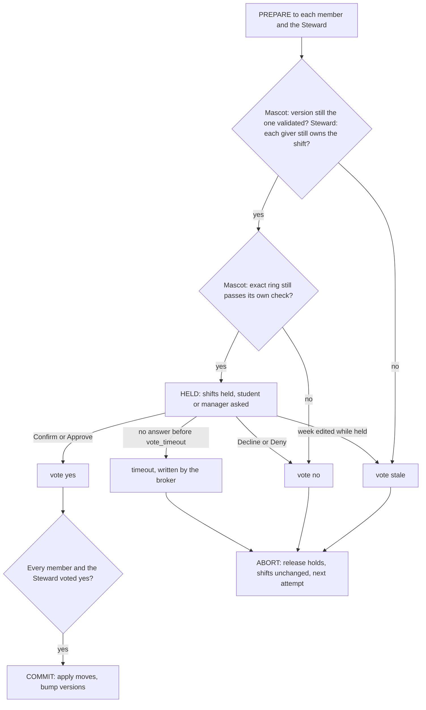

# Architecture

Tag Out runs as nine processes that talk over HTTP and JSON on 127.0.0.1. Agents never share memory or a database. This page lists the processes, every endpoint, the messages that cross between agents, the round engine, the two-phase commit and the freshness checks. Code paths are relative to the repo root.

## Processes and ports

| Process | Code | Port | State |
|---|---|---|---|
| Broker | `broker/app.py`, `broker/engine.py` | 8700 | in memory: requests, its copy of the roster, proposals, transactions; the public event log in `runtime/events.jsonl`. Also serves `web/` and the event stream. |
| Steward (Library) | `steward/app.py` | 8701 | in memory: the roster loaded from `seeds/ics/*_library.ics`, a roster version, pending holds, the manager's messages |
| Telegram bot relay | `bot/telegram_bot.py` | 8702 | chat-to-mascot links in `runtime/bot_links.json`; long-polls Telegram |
| Mascot: Ana, Ben, Dev, Priya, Zoe, Marco | `agents/mascot.py`, `agents/brain.py` | 8711 to 8716 | one SQLite file each, `runtime/mascot_<id>.db` (tables `kv`, `shifts`, `busy`, `outbox`, `diary`) |

`python -m scripts.run_all` starts the six mascots, the Steward and the broker with uvicorn, waits until each answers, then starts the bot if `TELEGRAM_BOT_TOKEN` is set and waits up to 30 seconds for it. If the bot doesn't come up, the demo carries on with the on-screen phones. It writes every URL to `runtime/registry.json`, which `core/net.py` reads; the defaults match the ports above. Each mascot writes its owner token to `runtime/tokens/<id>.txt`, where the bot reads it.

In tests and in the in-process replay, `scripts/inproc.py` mounts every app on one httpx client through ASGI transports. Each mascot keeps its own app object and its own SQLite file in a temp folder; only the transport changes. A `Wiretap` on that client records every request and response on the peer paths for the no-leak test.

Environment variables:

| Variable | Read by | Effect |
|---|---|---|
| `TAGOUT_ROLE` | broker, Steward | `broker` or `steward` makes the module build its app at import |
| `TAGOUT_STUDENT` | mascot | which student this process is |
| `TAGOUT_DEBUG` | all | `1` opens the demo and admin endpoints and lets owner endpoints skip the token. `run_all` always sets it, because the demo data is synthetic. |
| `TAGOUT_MODE` | mascot, Steward, broker | `auto` (default): synthetic students and the manager tap the first button after a delay. `live`: wait for real taps, and the broker uses live timing. |
| `TAGOUT_AUTO_DELAY` | mascot, Steward | seconds before an auto tap |
| `TAGOUT_FAST` | broker | `1` uses the fast timing the tests use |
| `TAGOUT_OFFLINE` | `ingest/llm.py` | `1` never calls the Anthropic API; cached answers or the regex parser only |
| `TAGOUT_LLM_EXPLAIN` | `agents/explain.py` | `1` lets Claude rephrase a mascot's texts to its student |
| `TAGOUT_RUNTIME`, `TAGOUT_REGISTRY`, `TAGOUT_ENV_FILE` | `core/net.py`, `ingest/llm.py` | override the runtime folder, the registry file and the `api.env` path |

## Endpoints

Peer-facing endpoints take and return only the closed schemas in `core/wire.py` (one exception is noted). Owner endpoints are the student's own channel and need the mascot's owner token in the `X-Owner-Token` header, unless `TAGOUT_DEBUG=1`. Demo and admin endpoints return 403 unless `TAGOUT_DEBUG=1`, except where the table says otherwise.

### Mascot (`agents/mascot.py`, ports 8711 to 8716)

Peer-facing:

| Method and path | Request | Response | Called by |
|---|---|---|---|
| `POST /round/pick` | `PickRequest` | `Pick` | broker, every swap, cover and extend round |
| `POST /ring/check` | `RingCheck` | `Eligibility` | broker, before selection |
| `GET /version` | | `VersionReport` | broker, before selection |
| `POST /txn/prepare` | `Prepare` | `{"vote": Vote or null}` | broker |
| `POST /txn/decide` | `Decision` | `{}` | broker |
| `POST /sunday` | `SundayCheck` | `{}`, so the broker never learns how many collisions there were | broker |
| `GET /public` | | `PublicFace` | broker, for the arena |
| `POST /busybits` | `SlotQuery` | `BusyBits` | Steward, for the crunch forecast |
| `GET /.well-known/agent-card.json` | | a fixed description of the mascot's three skills (pick, ring check, two-phase commit) in the shape of an A2A Agent Card | anyone; it holds only the student's first name |

Owner channel:

| Method and path | Body | Does |
|---|---|---|
| `POST /tap` | `{"data": "..."}` | a button tap: `trade:yes:<shift>`, `trade:no:<shift>`, `ask:yes:<shift>`, `ask:no:<shift>`, `confirm:<txn>`, `decline:<txn>` |
| `POST /intake` | `{"text": "..."}` | a student text: parsed into private busy blocks and preferences, then the schedule version goes up |
| `POST /pet` | `{"pet_id": "..."}` | the student's mascot choice (cosmetic) |
| `GET /phone?since=n` | | messages the mascot sent its student |
| `GET /diary?monday=YYYY-MM-DD` | | owner-only view: room before the limit that binds first, its rule id and quote, this week's shifts, collisions, diary lines, version |

Demo and admin: `POST /admin/reset` (reseed from `seeds/`, keep the owner token), `POST /admin/auto` (`{"enabled": bool, "delay": seconds}`), `GET /admin/debug` (the judge view of a synthetic student's private numbers).

### Steward (`steward/app.py`, port 8701)

| Method and path | Request | Response | Group |
|---|---|---|---|
| `GET /roster` | | `list[ShiftRef]` | peer-facing |
| `GET /people` | | `{id: name}` | peer-facing, not a wire schema |
| `GET /version` | | `{"agent_id": "steward", "version": n}` | peer-facing |
| `POST /txn/prepare` | `Prepare` | `{"vote": Vote or null}` | peer-facing |
| `POST /txn/decide` | `Decision` | `{}` | peer-facing |
| `POST /open` | `OpenShift` | `{}` | peer-facing, from the broker after the last attempt |
| `GET /forecast?monday=` | | per roster slot, how many staff are busy, only for slots with at least 3 | manager; the broker relays it at its own `/forecast` |
| `POST /tap` | `{"data": "approve:<txn>" or "deny:<txn>"}` | `{"reply": ...}` | manager channel, no token in this build |
| `GET /phone` | | the manager's messages | manager channel, no token in this build |
| `POST /admin/reset` | | | debug only |
| `POST /admin/auto` | `{"enabled": bool, "delay": seconds}` | | not gated in this build |

### Broker (`broker/app.py`, port 8700)

| Method and path | Request | Group |
|---|---|---|
| `POST /trade` | `TradeRequest` | from mascots |
| `POST /txn/vote` | `Vote` | from mascots and the Steward |
| `GET /events` | | public: server-sent events, the whole history first, then live |
| `GET /state` | | public: every mascot's `PublicFace`, the roster, the last summary, whether a run is going, the demo Monday, the debug flag, `seeds/pets.json` |
| `GET /agents` | | public: the registry and student names |
| `GET /sim` | | public: `docs/simulation.json` for the dashboard's simulator panel |
| `GET /forecast` | | public: the Steward's crunch forecast, counts only, relayed for the dashboard |
| `GET /`, `GET /judge`, `/web/...` | | the dashboard in `web/` |
| `POST /demo/sunday` | | demo: send `SundayCheck` to every mascot (not gated) |
| `POST /demo/run` | `{"wait": seconds}`, optional | demo: start a week in the background (not gated) |
| `POST /demo/break` | | debug: send Dev's "physical therapy thu 3pm" text through his intake |
| `POST /admin/reset` | | debug: reset the engine, the event log, every mascot and the Steward |
| `POST /admin/auto` | `{"enabled", "delay", "agents", "steward"}` | debug: auto taps on or off |
| `POST /admin/timing` | any of `pick_deadline`, `ask_window`, `vote_timeout`, `between` | debug |
| `GET /admin/judge` | | debug: every mascot's `/admin/debug` |
| `GET /phone/{who}`, `POST /phone/{who}/tap`, `POST /phone/{who}/text` | | debug: the on-screen phones, relayed to that mascot's (or the Steward's) owner endpoints |

### Telegram bot relay (`bot/telegram_bot.py`, port 8702)

`POST /send` (`{"student_id", "kind", "text", "buttons"}`) delivers a message to the chat linked to that mascot or to the manager, with a still frame of the student's pet for collision, ask, confirm, commit and abort messages. `GET /links` lists who is linked. Telegram commands: `/start`, `/join <name>`, `/pet`, `/week`, `/diary`, `/sunday`, `/trade`, `/help`. Plain texts go to the mascot's `/intake` and button taps to its `/tap`, both with the owner token.

## Message types

Every model in `core/wire.py` subclasses `Wire`, which sets `extra="forbid"` and `frozen=True`. A field that isn't declared is a parse error.

| Message | Fields | Sent |
|---|---|---|
| `ShiftRef` | `shift_id`, `employer`, `start`, `end`, `owner` | Steward to broker in `/roster`; broker to mascots inside `PickRequest`. These are roster facts the employer already shares with its staff. |
| `TradeRequest` | `agent_id`, `shift_id` | mascot to broker after its student taps "Find a trade" |
| `PickRequest` | `round_id`, `iteration`, `phase` (`swap`, `cover`, `extend`), `items` (a list of `ShiftRef`), `you_give` | broker to mascot |
| `Pick` | `round_id`, `iteration`, `agent_id`, `shift_id` (null is a pass) | mascot to broker |
| `Move` | `shift_id`, `from_agent`, `to_agent` | inside `RingCheck` and `Prepare` |
| `RingCheck` | `ring_id`, `moves` | broker to every member of a proposal |
| `Eligibility` | `ring_id`, `agent_id`, `ok` | mascot to broker |
| `VersionReport` | `agent_id`, `version` | mascot to broker |
| `Prepare` | `txn_id`, `ring_id`, `moves`, `seen_version` | broker to the members and the Steward |
| `Vote` | `txn_id`, `agent_id`, `vote` (`yes`, `no`, `stale`, `timeout`) | mascot or Steward to broker, or inside the PREPARE reply. `timeout` is only ever written by the broker. |
| `Decision` | `txn_id`, `outcome` (`commit`, `abort`) | broker to every participant |
| `SundayCheck` | `monday` | broker to mascot; the reply is empty |
| `SlotQuery` | `slots`: name to (start, end) | Steward to mascot |
| `BusyBits` | `agent_id`, `slots`: name to bool | mascot to Steward |
| `OpenShift` | `shift_id` | broker to Steward |
| `PublicFace` | `agent_id`, `name`, `pet_id`, `state`, `trades_made`, `badges` (only `Clutch`, `Chain Link`, `Streak`) | mascot to anyone |

The private models (`Student`, `Limits`, `Preferences`, `SoftAvoid`, `BusyBlock`, `Shift`, `Collision` in `core/models.py`) never cross the wire.

## The round engine

`Engine.run()` in `broker/engine.py` plays one week: up to 3 attempts, then a summary.

1. Requests. After the Sunday check, each student who taps "Find a trade" makes their mascot send a `TradeRequest`. The broker keeps shift id to owner and nothing else.
2. Open items. Each attempt starts with the requested shifts not yet fixed, ordered by start time, at most one per owner, and only while the requester still owns the shift on the broker's copy of the roster. The broker emits `round_open`.
3. Swap rounds (Top Trading Cycles). Every owner with an open item gets a `PickRequest` with `phase="swap"`, all open items, and `you_give` set to their own shift. The mascot picks the earliest open shift that its student is free for (no busy block, no other shift at that time, not a day they never work), that isn't in a soft-preference slot the student hasn't approved, and that passes `check_change(add=[that shift], drop=[their own])` in the Rulebook. If the only shifts that fit are in a soft-preference slot, it passes and asks its student, once per shift. The broker waits for every reply and for the pick deadline, whichever is later, and only then publishes the picks. A reply that fails, or names a shift that wasn't offered, counts as a pass. `find_cycles` closes every cycle in the pick graph (each agent points at most once). Cycle members leave with their trade and the rest go again. If nothing closes, the agents who passed keep their own shift and leave (standard TTC with outside options) and the rest re-point. The loop stops when fewer than 2 agents are left, nobody passed, or everyone passed.
4. Counter-offer window. If at least 2 owners are still unmatched and the ask window is above zero, the broker waits that long. Students answer their mascot's question, and the answer is stored privately for that shift. Then swap rounds run again over what is left. This is where Ana's "Take it" turns her pass into a pick.
5. Cover chains. Every mascot that doesn't own a remaining item gets a `PickRequest` with `phase="cover"`. A mascot whose student doesn't want more hours passes at once. For each helper who picks (in name order), the owner who just lost a shift gets `phase="extend"` with the remaining shifts of people not yet in the chain and `you_give` set to the shift they are losing. If they pick one they keep their hours and the chain grows; the last person in the chain drops their shift.
6. Validation. Every member of every proposal gets a `RingCheck` with the exact moves and answers with one ok bit from its own Rulebook check on that final ring. The broker also reads every member's `/version` and the Steward's. The public `validated` event carries only the proposal's overall ok.
7. Selection with CP-SAT (`broker/cpsat.py`). One boolean per proposal. A proposal with any member who said no is fixed to 0. At most one chosen proposal per person and per shift. The objective is 1000 per conflict fixed, plus 100 per owner who also takes a shift back (keeps their pay), minus 1 per move. The solver runs with one worker, seed 7 and a 2-second limit, so results repeat. Choosing nothing is a valid answer.
8. Two-phase commit, one chosen proposal at a time (next section).
9. If any commit aborted, the next attempt starts from step 2 with whatever is still open. Otherwise, or after the third attempt, the broker posts each unfixed shift to the Steward's `/open` and emits `summary` with `asked`, `fixed`, `open`, `by_ring`, `by_chain`, `pay_kept` and `open_shifts`.

Timing (`Timing` in `broker/engine.py`):

| | Default | Fast (`TAGOUT_FAST=1`, tests) | Live (`TAGOUT_MODE=live`) |
|---|---|---|---|
| `pick_deadline`: replies held until then | 1.0 s | 0 | 2.0 s |
| `ask_window`: counter-offer wait | 3.0 s | 0.05 s | 60 s |
| `vote_timeout`: confirmations | 30 s | 5 s | 300 s |
| `between`: pacing for the arena | 0.6 s | 0 | 1.0 s |

Public events on `/events`, in the order a week emits them: `sunday_check`, `trade_request`, `round_open`, `round`, `picks`, `released`, `counter_window`, `cycle`, `chain`, `validated`, `selected`, `prepare`, `vote`, `commit` or `abort`, `summary`. The demo adds `schedule_edited` and `reset`.

## Two-phase commit

`Engine.two_phase()` creates a transaction whose expected voters are the proposal's members plus the Steward, and sends `Prepare` to all of them at once.

Mascot side (`Brain.prepare`, `tap`, `decide`, `schedule_changed` in `agents/brain.py`):

- On `Prepare`: if `seen_version` differs from the current schedule version, reply `stale`. If the moves no longer pass its availability and Rulebook check, reply `no`. Otherwise store a hold (`txn_id`, `ring_id`, the version, the moves), text the student a Confirm/Decline card, and reply `{"vote": null}`.
- Confirm tap: vote `yes` if the held version still matches, otherwise `stale`. Decline tap: vote `no`, and the student is told nobody will learn why.
- Any edit to the student's week while a hold is open bumps the version and sends `stale` at once.
- On `commit`: apply the moves to its own shifts, bump the version, count the trade, award badges (Chain Link for a trade with 3 or more people, Streak at 3 trades), clear the fixed collision, and text "Done". On `abort`: drop the hold and text that nothing changed.

Steward side: on `Prepare`, vote `stale` if any move's giver no longer owns that shift on the roster; otherwise hold the moves, send the manager an Approve/Deny card, and reply `{"vote": null}`. Approve sends `yes`, Deny sends `no`. On `commit` it moves each shift to its new owner and bumps the roster version. On `abort` it drops the hold.

Broker side: votes for an unknown or finished transaction, or from someone who isn't an expected voter, are ignored. The first vote that isn't `yes` ends the wait at once. When the wait times out, every missing vote is recorded as `timeout`. The transaction commits only if every expected voter voted `yes`. The same `Decision` goes to every participant, then the broker emits `commit` or `abort`, and on commit it updates its copy of the roster and marks those requests fixed. `tests/test_twophase.py` checks this under random mixes of yes, no, stale and silent participants.

## Freshness

Two checks catch a trade that was built on an old view of someone's week.

- Schedule version per mascot. Each mascot's store keeps an integer version, set to 1 when it is seeded and bumped on every text through `/intake` and on every committed trade. The broker reads it during validation and sends it back as `Prepare.seen_version`. The mascot compares it at PREPARE, again when its student taps Confirm, and on every edit while a hold is open. That last check is the break-it beat: Dev's text bumps his version, his mascot votes `stale`, and the ring aborts before anything moves.
- Owner check per shift on the Steward. The Steward ignores `seen_version` and checks, for each move, that the giver still owns that shift. A single roster version would not work here, because the first proposal of a week to commit bumps it, and every later proposal in the same attempt would then look stale even when it touches different shifts.

The broker adds one more guard: an open item is only offered while its requester still owns it on the broker's roster copy.

## Where the code is

| Path | What is there |
|---|---|
| `core/wire.py` | the closed message schemas |
| `core/models.py` | private models that stay inside one mascot |
| `core/net.py`, `core/events.py`, `core/timeutil.py` | HTTP client and registry, the public event bus, Phoenix time helpers |
| `agents/` | the mascot app, its reasoning (`brain.py`), its SQLite store, the texts it sends its student (`explain.py`), and seeding from `seeds/` |
| `broker/` | the app, the round engine, TTC and chains (`ttc.py`), CP-SAT selection (`cpsat.py`) |
| `steward/app.py` | the employer's agent and the crunch forecast |
| `rulebook/` | `rules.py` (pure functions over one student's numbers) and `quotes.py` (refuses a quote that isn't verbatim in `docs/RULES.md`) |
| `ingest/` | ICS import for Canvas, calendars, shift exports and ASU's academic calendar; text intake with Claude and a regex fallback; the cached Claude wrapper |
| `bot/telegram_bot.py` | the phone line |
| `sim/` | the simulator and the brute-force oracle |
| `scripts/` | `run_all`, `demo`, `inproc`, `fetch_pets`, `make_fixtures` |
| `config/rules.yaml` | every limit as data |
| `seeds/` | the six synthetic students, their ICS files, the cached Claude answers for the demo texts, the pet list |

---

Not legal or immigration advice. Your DSO and ASU Student Employment decide. Rules are cited; limits are configurable.
